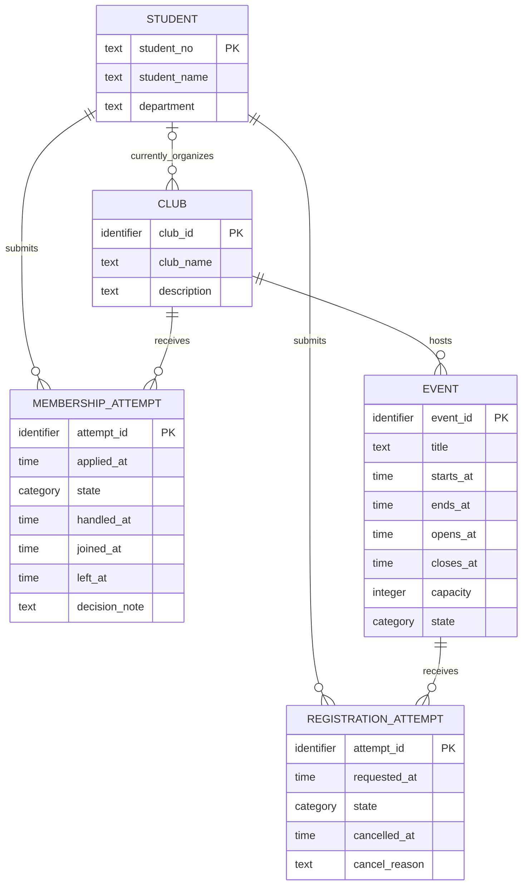

# Lab 2 参考答案

[题目](../Labs/Lab02-Conceptual-Design/Lab02.md) · [答案目录](README.md)

## 从业务里找对象

本答案采用五类有独立意义的东西：学生、社群、一次入社申请及其成员经历、活动、一次报名尝试。

“一次入社申请及其成员经历”合在一个对象里，是本参考政策的选择：每次申请最多获批一次、最多形成一段连续成员期间；退出后一定是新申请。如果实际业务允许一个获批申请反复冻结、恢复，就不能只用这一段期间，需要更多历史记录。

报名也按“尝试”看：取消后新报是另一次尝试。这样时间与取消结果都有归属，不会只剩一个当前状态。

对应任务一的两处判断：社群介绍依附于社群，没有本案例需要的独立生命周期，因此作为属性；报名尝试发生在学生与活动之间，又有独立的受理、取消和重报经历，因此本答案把它表达为关联对象，而不是学生身上的一个简单“是否报名”属性。

## 一张参考图

每次申请必须属于一个学生和一个社群；学生、社群可以暂时没有任何申请。每次报名必须属于一个学生和一场活动；活动可以无人报名。一场活动恰好一个主办社群，一个社群可以还没有活动。

当前负责人这一条表示：一个学生可以负责多个社群，一个社群可以暂时没有负责人、最多一位。负责人存在时才能走本参考版本的正常发布流程。管理员是外部操作身份，不为了凑角色而强行画成学生子类。

图中PK标识本参考模型选定的主标识属性；text、time等仅是业务类型提示，不是MySQL字段类型。下面补充属性含义：

- 学生：学号、姓名、院系；学号作业务标识。
- 社群：内部标识、名称、介绍；名称不保证唯一。
- 入社尝试：独立标识、申请时刻、状态、处理时刻、拒绝理由、加入与退出时刻。
- 活动：独立标识、标题、主办、举办起止、报名起止、容量、发布/取消状态。
- 报名尝试：独立标识、受理时刻、当前结果、取消时刻与原因。

尝试标识不代表必须用某一种数据库自增实现。它表达“同一对人和对象可以发生多次，而每次要分辨”。

## 两段历史怎样走

小林第一份申请获批，成员期间结束后，该尝试成为已退出；第二份申请另有标识和时刻。第一份不删，也不清空退出时间。拒绝申请有处理结果，但没有加入期间。

小周第一份报名取消，保留受理和取消时刻；第二份报名另建尝试。当前名单只取当前正式尝试，不是任意曾出现过的记录。

## 图外必须写的限制

同一学生同一社群至多一份待审或有效尝试；同一学生同一活动至多一份当前正式报名；当前人数不超容量；操作在窗口内；操作者具有业务权限。这些都不能只靠普通的二元基数完整表示。

“学生有多个联系渠道”可能用多值属性，也可以作为后续独立联系信息；当前最小需求不收集它们。是否弱实体取决于识别依赖，而不是“有外键就是弱实体”。本版本各尝试有独立标识，不强行采用弱实体画法。

也可以把申请与成员期间拆开，这不算错。你需要说明如何关联，并保证未批准申请没有有效期间、每次重入有据可查。

## 对应任务四：六个场景怎样检查

1. 未入社学生仍有学生资料，但没有有效申请经历；学生一端允许零参与。
2. 同一学生可有对应不同社群的有效经历，不把学生与社群限制为一对一。
3. 退出与重入对应两次尝试，第一段保留结束时刻，第二段另有申请与批准时刻。
4. 拒绝申请保留处理结果，但无有效加入期间，不混入成员名单。
5. 取消报名与重新报名对应两次尝试，当前只取仍正式有效的一次。
6. 活动即使没有任何报名仍可存在；活动与报名之间允许零参与。

容量上限和窗口时间作为图旁说明；是否多人负责、申请能否撤回等假设应与自己的需求一致。
